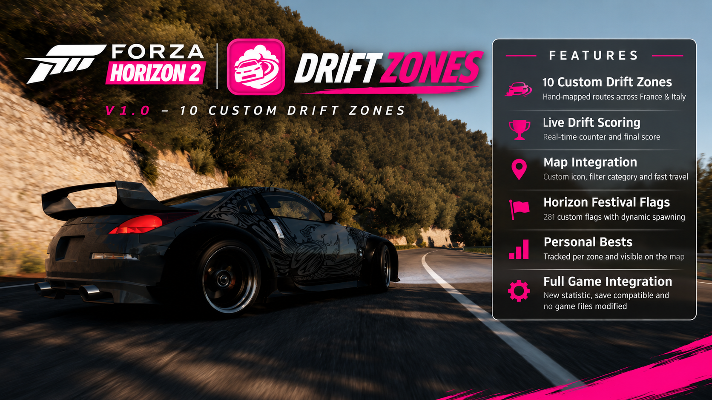

# Forza Horizon 2 – Drift Zones

  

  
<strong>Custom Drift Zones for Forza Horizon 2 on PC</strong>

  
  

**Bring the Drift Zone experience to Forza Horizon 2!**

Drift Zones introduces ten custom, point-based drifting challenges to the open world of Forza Horizon 2 on PC, inspired by the Drift Zones first introduced in Forza Horizon 3.

Drive through carefully recorded routes, earn Drift Skill Points, compete against your personal bests and follow custom Festival flags along the roads.

Every zone has its own map icon, start and finish gates, individual scoring and dedicated route.

All ten zones are distributed across France and Italy and have been individually driven and recorded in-game.

---

## Features

| Feature | Description |
|---|---|
| **10 Custom Drift Zones** | Ten individually recorded routes across France and Italy. |
| **Live Drift Scoring** | Tracks Drift Skill Points while driving through a zone. |
| **Point-Based Results** | Displays your final drift score when reaching the finish. |
| **Personal Best Tracking** | Saves an individual best score for every zone. |
| **Map Personal Best** | Displays your personal best directly on the world map. |
| **Custom Map Icon** | Dedicated Drift Zone icon. |
| **Dedicated Map Filter** | Separate Drift Zones category in the map filter. |
| **Fast Travel & Routing** | Works just like regular Speed Zones. |
| **Start & Finish Gates** | Custom gates define the beginning and end of every route. |
| **Festival Flags** | 281 dynamically loaded flags mark the routes throughout the world. |
| **Dynamic Flag Loading** | Flags appear and disappear depending on your distance from them. |
| **Regional Flag Colors** | Orange flags in France and blue flags in Italy. |
| **14 Languages** | Localized zone names and associated text. |
| **Correct Statistics** | Drift Zones are counted separately from Speed Zones. |
| **Runtime Loading** | All components load through FH2 Extra Options without modifying original game files. |

---

## Drift Zones

Version 1.0 includes ten custom routes across France and Italy.

| # | Drift Zone |
|---|---|
| 01 | Castelletto |
| 02 | Festival Loop |
| 03 | Forest Hairpins |
| 04 | South Coast |
| 05 | Forest Pass |
| 06 | Highland Trail |
| 07 | San Giovanni Loop |
| 08 | Montellino Hairpins (Gravel) |
| 09 | Field Track |
| 10 | Outskirts Bend |

Every route has been individually driven and recorded in-game to follow the actual roads rather than relying on automatically generated paths.

All ten Drift Zones are visible on the world map from the beginning.

---

## Drift Scoring System

Drift Zones evaluate your drifting performance instead of your average speed.

### How it works

1. Enter a Drift Zone through its start gate.
2. Start drifting along the marked route.
3. Your Drift Skill Points are tracked live.
4. Reach the finish gate to complete your run.
5. Your final result is displayed in the familiar Speed Zone-style results presentation.

### Personal Best System

Every Drift Zone maintains its own Personal Best.

- Individual best score for each zone.
- Personal Best displayed directly on the world map.
- Personal Best shown on the results screen.
- Automatically updated whenever you achieve a new record.

### Run Cancellation Rules

To ensure that runs are completed properly, Drift Zones include dedicated cancellation rules.

A run is cancelled if:

- **Standing still:** You remain stationary for more than 2 seconds.
- **Wrong direction:** You travel more than 30 metres in the opposite direction.
- **Leaving the road:** You remain off the road for more than 3 seconds.

**Rewinding is allowed.** You can use the game's rewind function without automatically cancelling your current Drift Zone run.

---

## Festival Flags

Drift Zones feature custom Horizon Festival flags placed throughout all ten routes.

A total of **281 flags** mark the roads, creating a visual guide that makes every Drift Zone feel like a dedicated Festival challenge.

### Flag Placement

- Flags are placed at the start and finish gates.
- Additional flags are positioned approximately every 30 metres along the route.
- Placement alternates between the left and right sides of the road.
- Flags are oriented at a 90-degree angle to the road.
- Individual placement corrections account for walls, buildings, guardrails and other obstacles.

### Dynamic Flag System

The flags are dynamically loaded during gameplay rather than being permanently active throughout the world.

- Flags begin appearing at approximately 320 metres.
- They fade in smoothly as you approach.
- They can be driven around and physically destroyed.
- Destroyed flags return automatically.
- Flags are unloaded again when they are no longer needed.

This keeps the world clean while ensuring that the routes are clearly marked when approaching a Drift Zone.

### Regional Colors

The flag colors reflect the region in which the Drift Zone is located.

| Region | Flag Color |
|---|---|
| France | Orange |
| Italy | Blue |

### Event Compatibility

Drift Zone scoring and Festival flags are automatically suspended during events.

When returning to Freeroam, both systems become available again.

---

## World Map Integration

Drift Zones are fully integrated into the existing Forza Horizon 2 world map.

| Feature | Implementation |
|---|---|
| Custom Icon | Dedicated Drift Zone map icon. |
| Map Filter | Separate Drift Zones category. |
| Zone Visibility | All ten zones visible from the beginning. |
| Fast Travel | Supported. |
| Route Setting | Supported. |
| Personal Best | Displayed directly on the map. |
| Localization | 14 language variants. |

The goal is to make Drift Zones feel like a natural part of the original Forza Horizon 2 experience.

---

## Statistics & Progression

Version 1.0 introduces corrected Drift Zone statistics and progression handling.

- Drift Zones are no longer counted as regular Speed Zones.
- The **Drift Zones Triggered** statistic now counts correctly.
- Existing save games are supported.
- Previously accumulated game progress is preserved.

No new save game is required.

---

## Localization

The mod includes 14 localized language variants:

| Language | Variant |
|---|---|
| English | United States |
| English | United Kingdom |
| German | Germany |
| French | France |
| Italian | Italy |
| Spanish | Spain |
| Spanish | Mexico |
| Portuguese | Brazil |
| Polish | Poland |
| Russian | Russia |
| Dutch | Netherlands |
| Japanese | Japan |
| Korean | South Korea |
| Chinese | Traditional |

All Drift Zone names and associated text are localized.

---

## Compatibility

| Game | Platform / Runtime | Status |
|---|---|---|
| Forza Horizon 2 | PC via Azimuth | Supported |

### Requirements

- Windows PC.
- Forza Horizon 2 (PC version).
- Compatible Azimuth installation.
- FH2 Extra Options with its runtime mod loader enabled.

This modification is specifically designed for the PC version of Forza Horizon 2 running through Azimuth.

---

## Installation

### Installation Steps

1. Open the [Drift Zones Releases page](https://github.com/Philipp55112/fh2-drift-zones/releases).
2. Download the latest **Drift Zones v1.0** release package.
3. Extract the downloaded archive.
4. Place the mod folder in the location used by your FH2 Extra Options mod-loader setup.
5. Keep the original directory structure intact.
6. Start Forza Horizon 2 through Azimuth with FH2 Extra Options and its runtime mod loader enabled.
7. Open the world map and look for the **Drift Zones** category.

**Important:** The exact target folder depends on your FH2 Extra Options configuration. Follow the same installation convention as your other runtime mods.

Do not move individual files out of the package or rename the mod components.

---

## Uninstallation

Removing Drift Zones is straightforward.

1. Close Forza Horizon 2.
2. Delete the installed Drift Zones mod folder.
3. Restart the game.

No original game files need to be restored or replaced.

**Your original Forza Horizon 2 installation remains untouched.**

---

## Technical Implementation

Drift Zones integrates into Forza Horizon 2 using custom game data and four dedicated runtime plugins.

### Runtime Plugins

The mod consists of four separate plugins:

| Plugin | Responsibility |
|---|---|
| **Drift Scoring** | Drift point calculation, live scoring, results presentation and Personal Best handling. |
| **User Interface** | World map integration, dedicated map filter category and zone visibility. |
| **Statistics** | Correct Drift Zone progression and statistic tracking. |
| **Drift Zones Logic** | Run cancellation rules, dynamic Festival flag loading, placement and event compatibility. |

### Custom Game Data

| Component | Purpose |
|---|---|
| Zone Definitions | Custom zone entries based on the game's existing Speed Zone data structure. |
| `GameObjs.xml` | Definitions for custom start and finish gate objects. |
| Map Profiles | Integration of Drift Zones into the world map. |
| Map Icons | Custom Drift Zone map icon. |
| `strings.json` | Localized names and text resources. |

### Runtime Loading

All components are loaded at runtime through FH2 Extra Options.

- No original game files are modified.
- No permanent game installation changes are required.
- All custom functionality is handled through runtime plugins.
- Removing the mod folder is sufficient to uninstall the modification.

### Logging

The release uses minimal logging to keep unnecessary log output to a minimum.

The main logic plugin generates a small `DriftZonesLogic.log` file:

- Recreated on every game start.
- Limited to a maximum of 200 lines.

The scoring plugin maintains its own small log file.

---

## Feedback & Bug Reports

Feedback, suggestions and bug reports are always welcome.

When reporting an issue, please include:

- Game version and Azimuth version.
- FH2 Extra Options version.
- Name of the affected Drift Zone.
- Steps to reproduce the issue.
- Screenshots or logs, if available.

**Report bugs or submit suggestions:**

[Open an Issue](https://github.com/Philipp55112/fh2-drift-zones/issues)

**Download the latest release:**

[Drift Zones Releases](https://github.com/Philipp55112/fh2-drift-zones/releases)

---

## Credits

| Contributor | Contribution |
|---|---|
| **Philipp55112** | Project concept, development, implementation, integration and release. |
| **Azimuth** | PC runtime used to run Forza Horizon 2. |
| **FH2 Extra Options** | Runtime mod-loading support. |
| **Alpha Testers & Community** | Testing, feedback and suggestions. |

Special thanks to everyone who helped test Drift Zones during development and contributed valuable feedback to make Version 1.0 possible.

---

## Disclaimer

Drift Zones is an unofficial community-made modification.

It is not affiliated with, endorsed by or supported by Microsoft, Xbox, Playground Games or Turn 10 Studios.

Forza Horizon 2 and all related game assets, names and trademarks belong to their respective owners.

Use this modification at your own risk.

---

## Distribution & Permissions

**© 2026 Philipp55112. All rights reserved.**

No permission is granted to redistribute, modify, repackage or publish this mod or its included files without prior permission from the author.

The release is distributed as a prebuilt package. Source code is not included.

---

## Related Projects

### Forza 21:9 Ultrawide Patch

A separate project by the same author, bringing true ultrawide UI support to Forza Horizon 2 and Forza Motorsport 5.

[Visit the Forza 21:9 Ultrawide Patch Repository](https://github.com/Philipp55112/fh2-ultrawide-ui)

---
